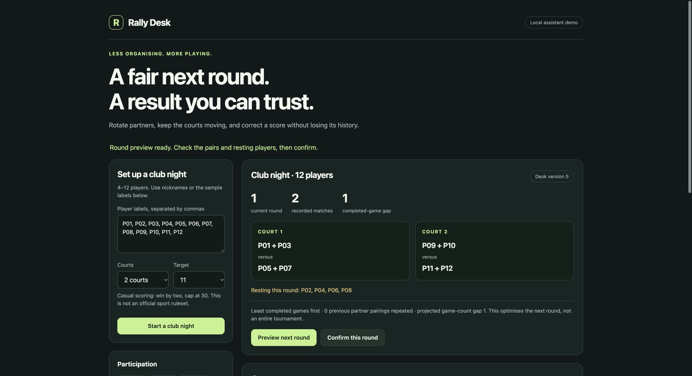

# Rally Desk

A local club-night coordinator: propose the next doubles round, rotate resting players, record results, and correct a result without erasing its history.

The browser is a **real MCP client**, using `initialize`, `tools/list` and `tools/call` over Streamable HTTP with protocol `2025-11-25`. It is a simulated assistant surface for an Alexa+ track candidate. There is no connection to an Alexa device, private Amazon preview, or watch. The browser uses explicit controls; it does not call a live language model or speech service.



## Run locally

Tested with Python 3.11.12 on macOS ARM64. The SDK requires Python 3.10 or later; other operating systems have not been tested here.

```sh
python3 -m venv .venv
.venv/bin/python -m pip install -r requirements.txt
.venv/bin/python server.py
```

Open `http://127.0.0.1:8767`. The MCP endpoint is `http://127.0.0.1:8767/mcp`.

On Windows, use `.venv\Scripts\python.exe` in place of `.venv/bin/python`. No API key, Amazon account, cloud host or payment card is used by this implementation. Installing dependencies requires network access; the running demo makes only loopback requests.

The default database lives in the operating system's temporary directory, outside Documents. It survives ordinary server restarts, but the operating system may remove temporary data. Use `--database PATH` for a deliberately chosen persistent file and `--port PORT` to change the listening port. This demo binds only to `127.0.0.1`; it has no remote-user authentication.

## Try the workflow

1. Start a club night with the twelve sample labels, two courts and target 11.
2. Preview a round. The proposal explains who rests and how previous pairings affect the choice. Confirming the exact preview commits it; previewing alone changes nothing.
3. Record the two completed results, for example `11–7` and `7–11` using the synthetic demo labels. Retry the last write: the version and match count stay unchanged.
4. Open the first recorded result, correct the sides to `7–11`, and give a reason. The history preserves both scores. Participation counts do not increase for a correction.
5. Preview the next round. Previously resting players get priority because they have completed fewer games.

Scores use the same casual first-to-11/15/21, win-by-two, cap-30 rules as the independently tested Rally Slate core. Results that would have continued past a previous winning point are rejected. These are not official competition rules for a named sport.

## What the planner guarantees

For the next round, players with fewer completed games are selected first. Among the remaining eligible choices, the planner compares doubles arrangements by consecutive rests, previous partner occurrences, previous opponent occurrences, then a deterministic tie break. It reports its objective and projected participation gap.

This is a declared **next-round policy**, not a claim of a globally optimal tournament, skill balancing, or field-tested enjoyment. It supports 4–12 labels, one or two courts, and up to 100 rounds per session. All pending matches must receive a completed result before the next round; interrupted-match cancellation and roster changes are not implemented.

## State and retry behavior

Every write supplies a UUID `request_id`. The same UUID and arguments return the original receipt with the latest state; reusing the UUID for a different action fails. A transaction checks `expected_version` before accepting a new write. Competing clients cannot silently overwrite a result. A round commit also verifies its preview hash. Corrections require a reason and append an audit event.

SQLite serializes the write, state update, audit event and receipt together. A browser refresh restores the last local session identifier. Compatible clients can retain session identifiers independently.

Tools: `create_session`, `get_session`, `plan_next_round`, `commit_round`, `record_result`.

## Verification

```sh
.venv/bin/python test_domain.py
# With server.py running on port 8767:
.venv/bin/python test_http.py
```

The domain checks need a C++17 compiler for the independent oracle in `reference/Score.hpp`. They enumerate reachable states through the original C++ scoring engine and compare all 2,883 target/score combinations with the Python validator. They also check six rounds of twelve players on two courts, competing writers, identical retries, stale previews and score corrections.

The HTTP checks exercise actual protocol negotiation, tool discovery, planning, commits, result recording, stale writes, duplicate delivery, correction history and rejection of an unrelated Origin. Their raw development reports remain local. See [validation-scope.json](validation-scope.json) for the measured release scope.

## Origin and limits

Prepared by a coding agent under brodyga45's business direction. No substantive human code review, real-player playtest, hardware test, customer acceptance or prize is claimed. The underlying watch scorekeeper predates this MCP extension within the current hackathon window; this extension adds club-wide planning, persistent multi-client state and a browser MCP workflow. It does not modify or synchronise the watch app.

Alexa scorekeepers already exist; this is not a claim to have invented voice scorekeeping. The tested distinction is the combined planning, explainable rotation and transactional correction workflow. Audience usefulness and competitive quality remain unproven.

Original code and the included original scoring reference are MIT. The official MCP Python SDK is an MIT dependency, installed from PyPI rather than vendored. This repository does not include the virtual environment, model weights, private credentials or development databases.
